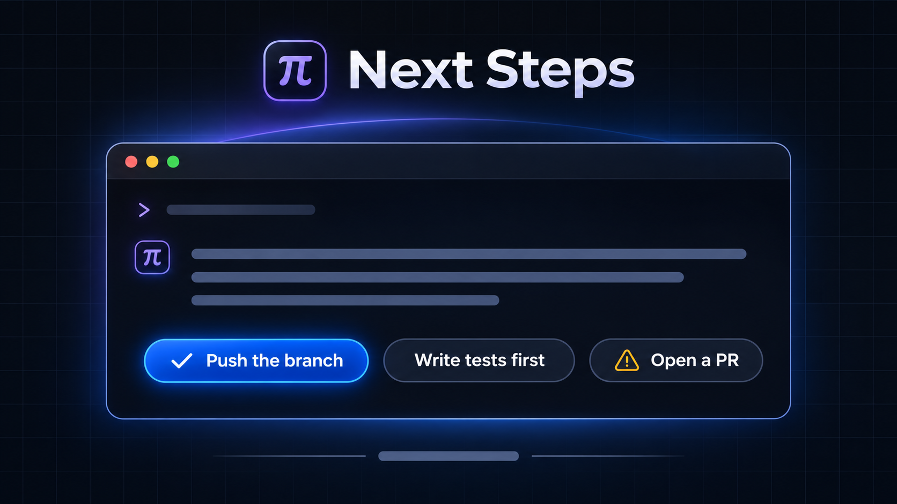

# pi-next-steps



**Next Steps** puts the end of a reply to work. Instead of the agent asking "say the word and I'll push the branch", the reply ends with a row of selectable steps, and one pick sends that step as the next message. Pick several and one send delivers them together.

A Pi port of the Hermes **Next Steps** plugin, adapted for the Pi coding agent's extension API.

## Features

- **Tool-driven offers.** The agent calls the `next_steps` tool with 2-6 short option strings at the end of a choice reply.
- **Recommended marks.** Options the classifier prefers carry a `★` tag and start selected. Several may be recommended when the steps belong together.
- **Risky pills.** An option that could damage files, a build, or money carries a `⚠` tag. Off by default.
- **Subtitles.** A chip can carry a dim second line when the label alone would be read wrongly.
- **Multi-select.** Pick comma-separated indices (`1,3`) and one send delivers them together.
- **Auto-classification.** When `rec`/`risky` are omitted, the extension asks the session model to classify the options (best-effort).
- **System-prompt guidance.** The model is told to call `next_steps` at choice points instead of asking in prose.

## Install

```bash
pi install /absolute/path/to/pi-next-steps
# or, once published:
pi install git:github.com/apoapostolov/pi-next-steps
```

Then reload Pi so the extension loads.

## Usage

The agent calls `next_steps` automatically when a reply ends with a choice. You can also invoke it manually from the TUI:

```
/ns
```

Type comma-separated indices (e.g. `1,3`) or a single number, then press Enter. The chosen step(s) are sent as the next user turn (queued if the agent is busy).

Alias: `/nextsteps`.

## Tool parameters

| Parameter | Type | Description |
|---|---|---|
| `options` | `string[]` | The option labels to offer (2-6 recommended). |
| `multi` | `boolean` | Allow picking multiple (default `true`). |
| `rec` | `string` | Comma-separated 1-based indices to mark recommended. |
| `risky` | `string` | Comma-separated 1-based indices to mark risky. |
| `subtitles` | `string[]` | Optional dim second lines, one per option. |

## Example directive (no tool calling)

When tool calling is unavailable, the same row can be expressed as a directive:

```
::nextsteps{multi="1" rec="1" risky="2" q1="Push the branch and open the PR" q2="Force-push over the review commit" q3="Write the release note first" d2="Rewrites origin, discarding the commit already there"}
```

## Requirements

- Pi 1.5+
- A Nerd Font (for the `★`/`⚠` glyphs) is recommended but not required.

## Limits

- A step is a sentence. A vague option sends a vague request; the plugin does not rewrite what the agent wrote.
- Ticks are per block. Two blocks in one reply keep separate picks.
- The RISKY pill is an opinion from a classifier reading labels and context, not a reading of your repository.
- Auto-classification is best-effort and may fail on providers that require extra headers (e.g. opencode-go).

## License

MIT. Inspired by [Follow-up Chips](https://github.com/nuonrg/hermes-plugin-followup-chips) and the Hermes Next Steps plugin.
